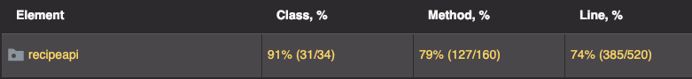

# Simple Java API Service# RecipeAPI – Simple Java REST APIThis repository contains a simple Java API project that demonstrates best practices for building a production-ready API using Java +17. The project incorporates various featuresand technologies commonly used in professional Java applications: Spring Web, Docker, logging, unit tests, functional tests and monitoring.## Project Overview## Test Coverage91% Classes | 79% Methods | 74% LinesRecipeAPI is a Java-based RESTful API application that allows users to manage their favourite recipes. Users can create, retrieve, update, delete, and search recipes based on different criteria.---The application is developed using **Java 17**, **Spring Boot**, and **Maven**. It demonstrates software development best practices, including layered architecture, database integration, API security, automated testing, logging, and containerisation.# Assessment## Main Features## ObjectiveCreate a standalone java application which allows users to manage their favourite recipes. It should allow adding, updating, removing and fetching recipes. Additionally usersshould be able to filter available recipes based on one or more of the following criteria:1. Whether or not the dish is vegetarian2. The number of servings3. Specific ingredients (either include or exclude)4. Text search within the instructions.- Create new recipes.- Retrieve all available recipes.- Retrieve a specific recipe.- Update existing recipes.- Delete recipes.- Filter recipes based on vegetarian status.- Search recipes by number of servings.- Include or exclude specific ingredients.- Search recipe instructions using text keywords.## Search ExamplesThe application's API supports the following search requests:The API supports searches such as:1. Get all vegetarian recipes2. Get recipes that serve 4 persons and include "potatoes" as an ingredient3. Get recipes that do not include "salmon" as an ingredient and have "oven" in the instructions1. Retrieve all vegetarian recipes.2. Find recipes that serve four people and include potatoes.3. Find recipes that exclude salmon and contain the word "oven" in their instructions.## Requirements## Technology StackPlease ensure that we have some documentation about the architectural choices and also how to run the application. The project is expected to be delivered as a GitHub (or any otherpublic git hosting) repository URL.| Technology | Purpose ||---|---|| Java 17 | Main programming language || Spring Boot | Application framework || Spring Web | REST API development || Spring Data JPA | Database operations || Hibernate | Object-relational mapping || MariaDB | Production database || H2 Database | Development and testing database || Spring Security | API security and API-key validation || Spring Actuator | Application health monitoring || Maven | Dependency and build management || JUnit 5 | Unit testing || Mockito | Mocking and testing || Docker | Application containerisation || Swagger / OpenAPI | API documentation || SLF4J | Application logging || MapStruct | Object mapping |All these requirements needs to be satisfied:## System Architecture- [x] The application must be implemented as a RESTful API using Java. You are free to choose a Java framework of your preference.The application follows a layered architecture based on the Model-View-Controller (MVC) approach and Repository pattern.[Spring Boot](https://spring.io/projects/spring-boot) was used for easily start the project,using [Spring Web](https://docs.spring.io/spring-framework/docs/current/reference/html/web.html) for managing the RESTAPI, [Spring Actuator](https://docs.spring.io/spring-boot/docs/current/reference/html/actuator.html) forhealth-check, [Spring Data JPA](https://docs.spring.io/spring-data/jpa/docs/current/reference/html/#reference) for the DBconnection, [Spring Security](https://docs.spring.io/spring-security/site/docs/current/reference/html5/) for the API-Key validation and endpoint securitychecks. [Spring Validation](https://docs.spring.io/spring-framework/docs/3.2.x/spring-framework-reference/html/validation.html) was used for API RequestBody validation.The main architectural components include:- [x] Ensure that the code is production-ready, adhering to best practices and design patterns.- **Controller Layer:** Handles incoming HTTP requests and API responses.- **Service Layer:** Contains the application's business logic.- **Repository Layer:** Manages database operations using Spring Data JPA.- **Entity Layer:** Represents the application's database entities.- **DTO (Data Transfer Object):** Transfers data between application components.- **Database Layer:** Stores recipe information using MariaDB or H2.The code is well documented, it was commited using [ConventionalCommits](https://www.conventionalcommits.org/en/v1.0.0/), it logs where it is needed and was build usingproduction-ready design patterns: Factory Pattern, Singleton, MVC, DTO, Repository, ec. It also include compile processors such as [Google Error Prone](https://errorprone.info/)and[Spring DevTools](https://docs.spring.io/spring-boot/docs/1.5.16.RELEASE/reference/html/using-boot-devtools.html) to comply with standard best-practices.These architectural choices improve code organisation, maintainability, reusability, and testability.- [x] Document the REST API endpoints and their usage for future reference.## Project Requirements[springdoc-openapi](https://springdoc.org/) was used to automatically generate a SwaggerUI available at `/swagger-ui` and `/api-docs`.The application addresses the following requirements:- [x] Persist the data in a database for reliable storage and retrieval.- [x] Implement a RESTful API using Java.- [x] Use a Java framework such as Spring Boot.- [x] Apply appropriate software design patterns and coding practices.- [x] Provide documentation for REST API endpoints.- [x] Persist application data using a database.- [x] Include unit tests.- [x] Include integration tests.- [x] Support Docker containerisation.The application uses [Spring Data JPA](https://docs.spring.io/spring-data/jpa/docs/current/reference/html/#reference) ([Hibernate](https://hibernate.org/orm/documentation/5.5/))for database connection, [H2 Database](https://www.h2database.com/html/main.html) in memory database for development environment (`spring.profile: dev`)and [MariaDB](https://mariadb.com/kb/en/documentation/) JDBC connector for production (`spring.profile: prod`), the later also available for develompent using the included Dockercompose image. The Entity Mapping was done with [MapStruct](https://mapstruct.org/documentation/stable/reference/html/).## Testing- [x] Include unit tests to verify the functionality of individual components.The project includes automated testing to verify application functionality and reliability.[SpringBootTest](https://docs.spring.io/spring-boot/docs/current/reference/html/features.html#features.testing.spring-boot-applications) was used for Unit Tests, thisincludes [JUnit](https://junit.org/junit5/docs/current/user-guide/) and [Mockito](https://javadoc.io/doc/org.mockito/mockito-core/latest/org/mockito/Mockito.html).- **JUnit 5:** Tests individual application components.- **Mockito:** Creates mock objects for isolated testing.- **Spring Boot Test:** Supports application-level testing.- **MockMvc:** Tests HTTP requests and controller responses.- **H2 Database:** Provides an in-memory database for testing.- [x] Integration tests must be present to test the interaction between different parts of the application.## API Documentation[SpringBootTest](https://docs.spring.io/spring-boot/docs/current/reference/html/features.html#features.testing.spring-boot-applications)and [AutoConfigureMockMvc](https://docs.spring.io/spring-boot/docs/current/reference/html/features.html#features.testing.spring-boot-applications.testing-autoconfigured-mvc-tests)were used to create the integration tests, using H2 in memory database for test environment.The application uses Springdoc OpenAPI to generate interactive API documentation.- [x] Container compatibilityAfter starting the application, access the documentation through:[Google JIB](https://cloud.google.com/java/getting-started/jib?hl=it) was used to build the Java Docker Image and Docker Containers for testing locally.- Swagger UI: `http://localhost:8080/swagger-ui/index.html`- OpenAPI JSON: `http://localhost:8080/api-docs`---## Prerequisites## Architecture and DocumentationBefore running the application, ensure that the following software is installed:The Recipe Service is a production-ready Java application that provides a RESTful API for managing favorite recipes and ingredients. It leverages popular frameworks and tools,including Spring, Spring Boot, Hibernate, Spring Data JPA, MariaDB, H2, SLF4J, JUnit, Docker, and Swagger API documentation. The project uses Java 17 and Maven for building anddependency management.- Java Development Kit (JDK) 17 or later.- Apache Maven (if not using the Maven Wrapper).- Docker (optional, for containerisation).- Git.The selection of these libraries and tools was driven by their maturity, community support, and ability to seamlessly integrate with each other. Here's an overview of their rolesin the application:## Getting Started- **Spring**: The Spring framework offers extensive support for developing enterprise-grade Java applications, including dependency injection, data access, and transaction  management. It promotes modular and testable code.To obtain the project, clone the team repository:- **Spring Boot**: Spring Boot simplifies the development of stand-alone, production-ready Spring applications by providing opinionated defaults and auto-configuration. It  eliminates boilerplate configuration, allowing developers to focus on business logic.```bashgit clone https://github.com/NeoZmanLAA/RecipeAPI.gitcd RecipeAPI```- **Hibernate**: Hibernate is an industry-standard Object-Relational Mapping (ORM) framework. It simplifies database operations by mapping Java objects to database tables and  providing an intuitive API for querying and manipulating data.For detailed installation instructions, dependency information, database configuration, and commands to build and run the application, refer to [SETUP.md](SETUP.md).- **MariaDB**: MariaDB is a robust, open-source relational database management system. It is known for its performance, scalability, and compatibility with MySQL, making it an  ideal choice for data persistence.## Version Control and Team Collaboration- **H2**: H2 is an in-memory database engine that facilitates rapid development and testing. It allows developers to run tests against an in-memory database, ensuring a fast and  isolated test environment.This project is maintained using **Git and GitHub** for version control and team collaboration.- **SLF4J**: SLF4J provides a logging facade for various logging frameworks, including Logback and Log4j. It offers a unified logging API, enabling flexible logging configurations  and integration with different logging implementations.The team uses the following practices:- **JUnit**: JUnit is a widely-used testing framework for Java applications. It supports writing unit tests that verify the correctness of individual components, ensuring  robustness and maintainability.- A shared GitHub repository for project management.- Individual branches for team members to develop and manage changes.- Meaningful commit messages to record development activities.- Pull Requests to review and merge changes into the main branch.- A shared project configuration to maintain consistency.- **Docker**: Docker enables the packaging of applications and their dependencies into lightweight containers. It simplifies deployment, scalability, and portability by providing a  consistent runtime environment.## Repository Structure- **Swagger**: Swagger is an industry-standard toolset for documenting and interacting with APIs. It generates interactive documentation, making it easier to understand and consume  the API endpoints.```textRecipeAPI/├── .mvn/├── src/│   ├── main/│   └── test/├── .gitignore├── mvnw├── mvnw.cmd├── pom.xml├── README.md└── SETUP.md```## Prerequisites*Note: This is a simplified representation of the project structure.*- Java +17- Maven- Docker## Original Project## Getting StartedThe application is based on the original Simple Java API project:Follow the steps below to run the application:1. Clone the [GitHub repository](https://github.com/parolaraul/simple-java-api)2. Set up your development environment with JDK 17 and Apache Maven.3. Configure the MariaDB database connection in the `application.yml` file, specifying the database URL, username, and password. Or launch the Dockerized mariadb included   in `/src/docker/mariadb.yml`4. Build the project using Maven:   ```shell   mvn clean install   ```5. Run the application using Maven:   ```shell   mvn spring-boot:run   ```6. Access the API documentation by visiting the Swagger UI endpoint: `http://localhost:8080/swagger-ui.html`. Use this interface to explore the available API endpoints and test   them interactively.If you prefer running the application in a Docker container, perform the following additional steps:7. Build the Docker image from the project's root directory, il builds the image 'recipeapi' with tag 'latest':   ```shell   mvn compile jib:dockerBuild   ```8. Run the Docker container using the container description `src/docker/app.yml`:9. Access the API documentation at the appropriate Docker container IP address and port: `http://localhost:8443/swagger-ui.html`.https://github.com/parolaraul/simple-java-apiThe original project has been imported into the team's GitHub repository for collaborative development and version control.


  

    
  

  
