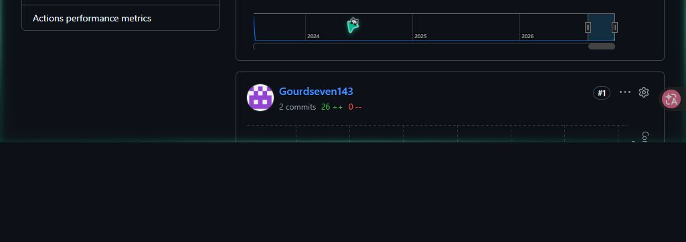

# Part 3 — Evidence of Individual Contributions

Repository: https://github.com/NeoZmanLAA/RecipeAPI  
Prepared by: Ze Ren Lang Jia (227167), GitHub account `NeoZmanLAA`  
Verified on: 24 November 2026

## Contribution record

Counts are taken from `git log --all` on the repository clone, excluding the 14 commits by the original upstream developer (Raul Parola). Yue Fansen's total includes two merge commits; the Contributors graph counts only non-merge commits on `main`, which is why it shows a smaller number.

| No. | Member | GitHub account | Feature branch(es) | Commits | Main changes |
|---|---|---|---|---|---|
| 1 | NURUL SAMEHAAH BINTI NORDIN (210071) | `Samehaah2200` | `NurulSamehaah210071-part2`, `NurulSamehaah210071-part2-1`, `NurulSamehaah-patch-1`, `member/samehaah-210071`, `member/Samehaah-210071` | 5 | Setup guide for the Recipe Service REST API; README project overview and clarity revisions |
| 2 | WANG TAO (231770) | not yet available — the link shared in the group (`taowl11572-bip`) returns 404 | — | 0 | Awaiting a feature branch and first commit |
| 3 | Ze Ren Lang Jia (227167) | `NeoZmanLAA` | `part3-contribution-evidence` | 1 | This contribution evidence record and the Contributors screenshot (Part 3) |
| 4 | YUE FANSEN (213843) | `Gourdseven143` (commit author also appears as `FANSEN YUE`) | `feature/member-a`, `feature/member-b` | 5 | Merge-conflict demonstration files for Member A and Member B, conflict resolution, and two pull-request merges |
| 5 | Shu Sheng (231169, shown as Ssvane in the group) | `ssvane849-pixel` | `part6-ai-verification` | 1 | Part 6 AI verification evidence and usage log |
| 6 | YAN NING (227124) | `Gin513` (commit author `YanNing`) | `feature/part5-architecture` | 1 | System architecture overview and execution flow trace |

**Outstanding item:** Wang Tao still needs to create a feature branch and push at least one commit. Every member must have a contribution on record for this part.

## Contributors page evidence

Live page: https://github.com/NeoZmanLAA/RecipeAPI/graphs/contributors

## Team working rules (for presentation)

1. Each member works on their own feature branch; nobody commits directly to `main`.
2. Commit messages state what was changed, so the history is readable.
3. Changes reach `main` through a pull request with a review by another member.

## Demo sequence

Branch list → commit history → point out each member's commit → Contributors graph to close.
